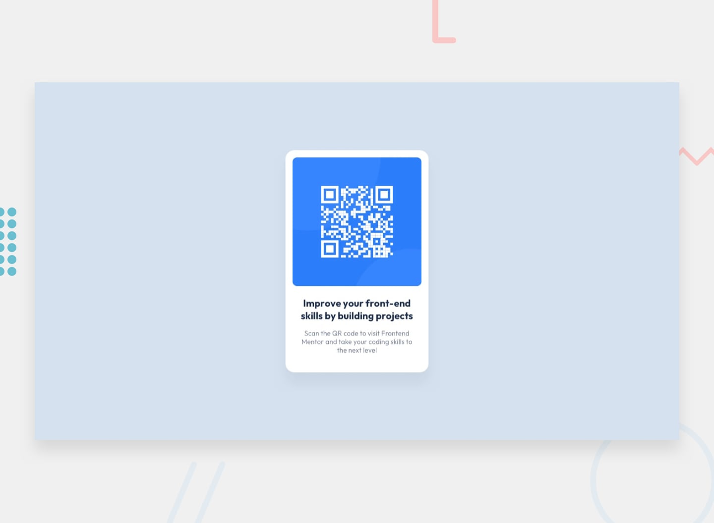

# QR Code Component

A solution to the [QR Code Component challenge](https://www.frontendmentor.io/challenges/qr-code-component-iux_sIO_H) from Frontend Mentor.

## Overview

This project is a simple QR code component built with HTML and CSS. The goal was to recreate the design provided by Frontend Mentor and practice building a clean, centered card layout.

## Screenshot

## Live Site

[View the live site](https://snzScripts.github.io/QR-code-component/)

## Built With

- HTML5
- CSS3
- CSS Flexbox
- Responsive design
- Google Fonts (Outfit)

## What I Learned

- How to use Flexbox to center a component horizontally and vertically.
- How to style a card using padding, border-radius, and width.
- How to use Google Fonts in a project.
- How to make a layout responsive using CSS.
- How to upload a project to GitHub and publish it using GitHub Pages.

## Challenges

Matching the card dimensions, spacing, and typography to the provided design was a challenge. I also practiced making the card fit different screen sizes.

## Continued Development

I want to keep practicing responsive layouts, CSS positioning, and building more projects with HTML and CSS.

## Author

- GitHub: [@snzScripts](https://github.com/snzScripts)
- Frontend Mentor: [@snzScripts](https://www.frontendmentor.io/profile/snzScripts)
